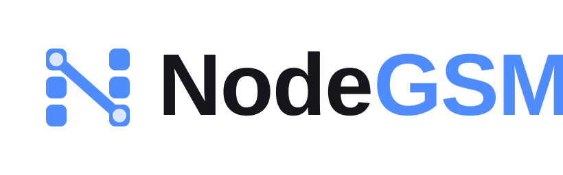
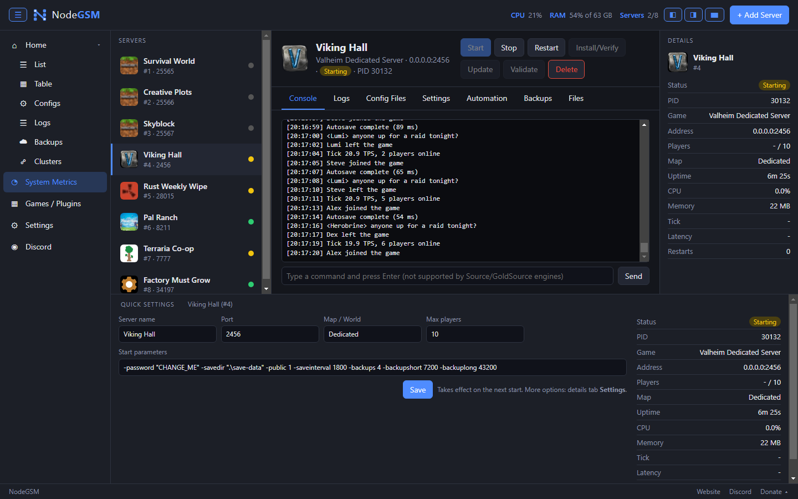
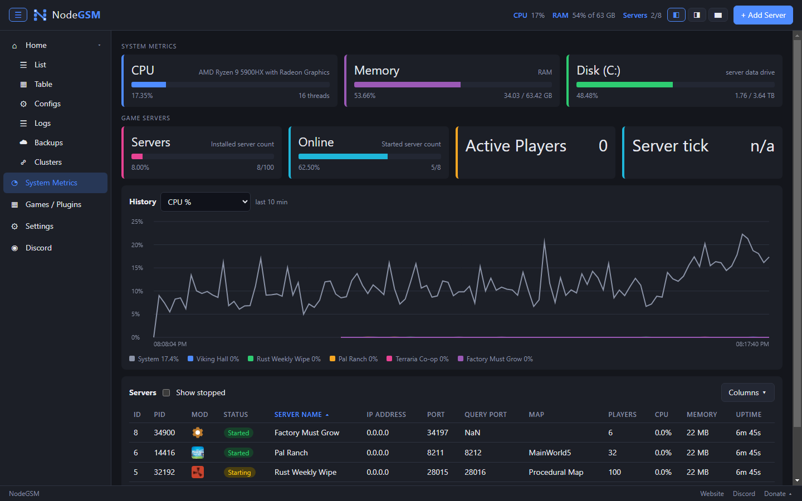
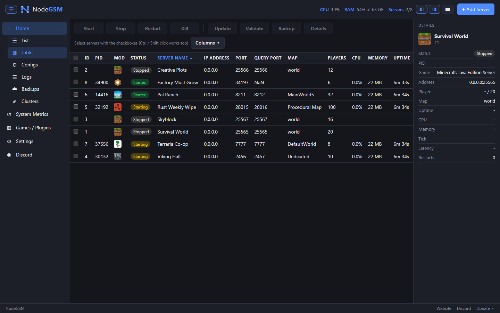
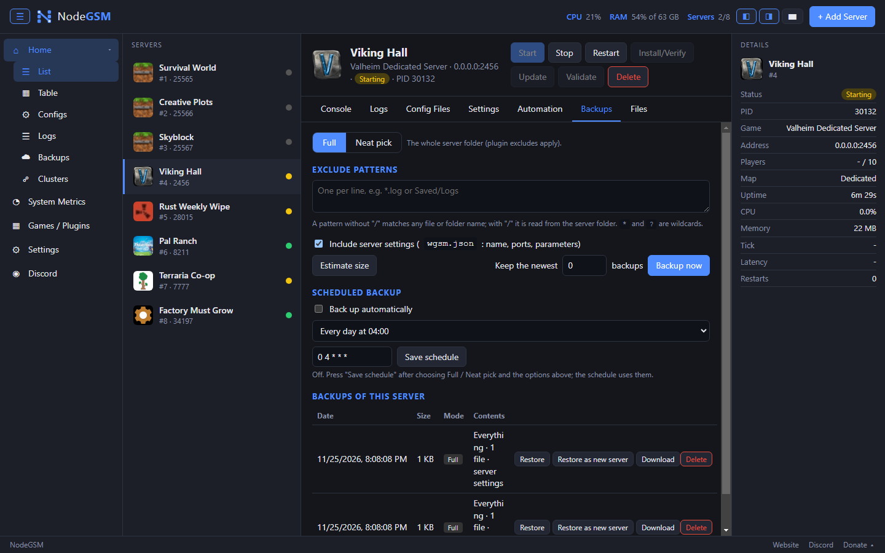
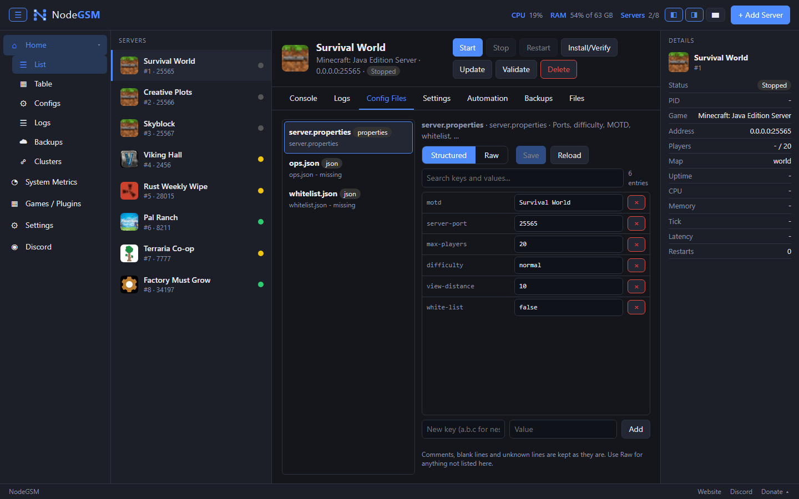
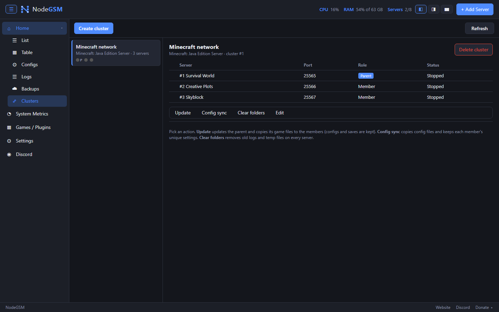
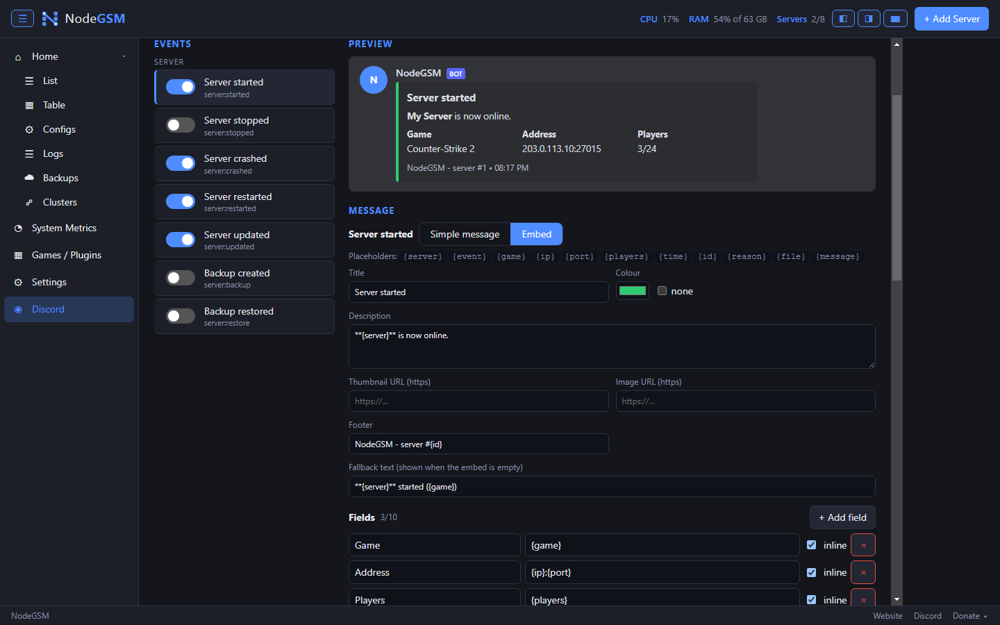
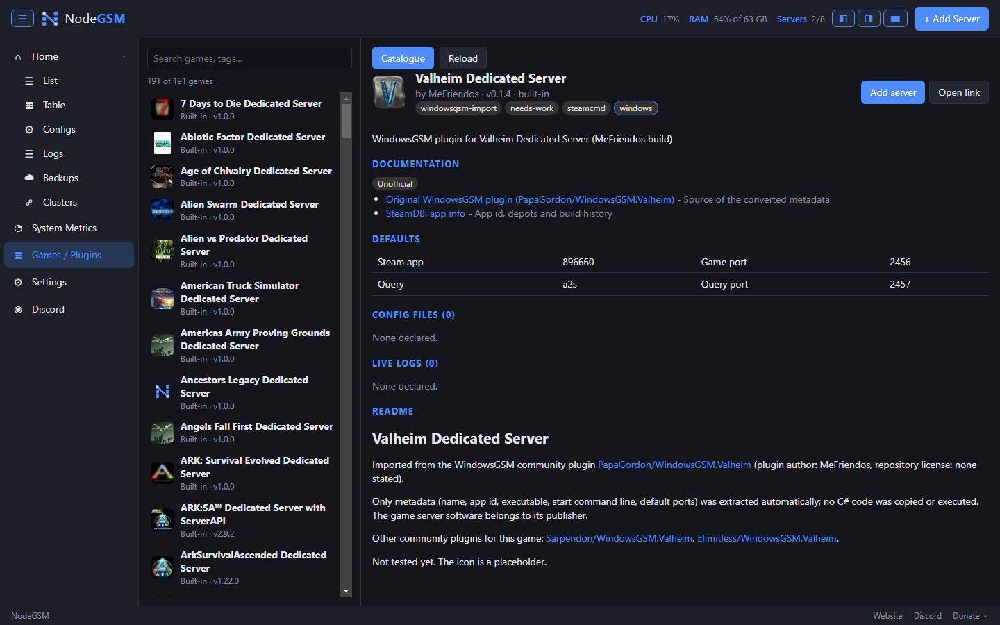

<p align="center"></p>

<p align="center"><b>NodeGSM - Node Game Server Manager</b><br>Install, run and automate game servers with one click.</p>

An Electron rewrite of [WindowsGSM](https://github.com/WindowsGSM/WindowsGSM) - manage game servers with a GUI: install, import, start, stop, restart, update and automate multiple servers.

**Every supported game is a plugin** (a folder with a `plugin.json` in [`plugins/`](plugins)). New games and fixes for outdated ones are added by pull request - no app code, no compiling. See [CONTRIBUTING.md](CONTRIBUTING.md).

## Screenshots
<table>
<tr>
<td width="50%"><a href="docs/screenshots/01-server-list.png"></a><br><sub><b>Servers</b> - list, details, live console, quick settings</sub></td>
<td width="50%"><a href="docs/screenshots/12-system-metrics.png"></a><br><sub><b>System Metrics</b> - CPU, memory, disk, players, history</sub></td>
</tr>
<tr>
<td width="50%"><a href="docs/screenshots/07-server-table.png"></a><br><sub><b>Table</b> - multi-select and bulk Start / Stop / Restart / Update / Backup</sub></td>
<td width="50%"><a href="docs/screenshots/04-server-backups.png"></a><br><sub><b>Backups</b> - Full or Neat pick, schedule, restore as new server</sub></td>
</tr>
<tr>
<td width="50%"><a href="docs/screenshots/06-server-config-files.png"></a><br><sub><b>Config files</b> - Structured or Raw editor</sub></td>
<td width="50%"><a href="docs/screenshots/11-clusters.png"></a><br><sub><b>Clusters</b> - update, sync configs, clear folders together</sub></td>
</tr>
<tr>
<td width="50%"><a href="docs/screenshots/18-discord-embed-editor.png"></a><br><sub><b>Discord</b> - alerts, embed editor with live preview, slash-command bot</sub></td>
<td width="50%"><a href="docs/screenshots/13-games-plugins.png"></a><br><sub><b>Games</b> - every game is a plugin</sub></td>
</tr>
</table>

All 22 screens, and how they are made: [docs/SCREENSHOTS.md](docs/SCREENSHOTS.md).

## Run
```
npm install
npm start
npm test        # tests + plugin validation
```

## Run in a browser (web mode, Linux)
NodeGSM also runs without Electron as a headless server you control from a browser, on Windows or Linux:
```
npm ci --omit=dev      # no Electron needed
npm run serve          # http://127.0.0.1:8730 - the first start prints the access token once; open the page and create the owner account
```
- **Accounts:** the first visit shows a setup page (the access token printed on first start, or `NODEGSM_TOKEN`, is needed once) to create the owner account. After that people sign in with username + password, optionally with an authenticator app (TOTP). Roles: owner, admin, viewer. Lockout, rate limit and an audit trail in the NGSM log. Binds `127.0.0.1` by default; it refuses a public bind without authentication. There is **no built-in TLS**: put a reverse proxy in front (`deploy/nginx.conf.example`) and read [Putting NodeGSM on the internet](docs/GUIDE-web-linux.md#putting-nodegsm-on-the-internet) before exposing it.
- **From the desktop app:** **Settings > Web access** serves the same page from the running exe (no second program). It starts with the app; with *Start NodeGSM on Windows login* the app starts in the tray, so the page is back after a reboot and sign-in. Network access is refused until an owner account exists.
- Docker: `docker compose -f docker-compose.example.yml up -d --build` (see `Dockerfile`); systemd: `deploy/nodegsm.service`.
- **Security notes:** an owner or admin account gives full control of your game servers (files, console, RCON) - use strong passwords, two-factor, TLS, a dedicated unprivileged user and publish only the game ports. Desktop-only features (folder picker, open in Explorer, tray, start on login, restart) are hidden in web mode.
- **Linux is declared but untested:** the platform layer is unit-tested only and the games `mc`, `csgo`, `rust`, `palworld` are *declared, untested* for Linux. Everything else stays Windows only. Full guide: [docs/GUIDE-web-linux.md](docs/GUIDE-web-linux.md).

## Build an exe
```
npm run dist    # installer + portable exe in dist/
npm run pack    # unpacked folder only (faster, for testing)
```
**Release on GitHub (automatic).** Bump the version and push the tag; the Release workflow does the rest:
```
npm version minor              # or patch / major: edits package.json, commits, tags v0.x.0
git push --follow-tags         # the tag triggers .github/workflows/release.yml
```
It runs the tests, builds the installer and portable exe and publishes them to a GitHub Release (a tag with a dash, like `v0.2.0-beta.1`, becomes a pre-release). Do not push a tag that does not match the `package.json` version: the workflow stops with an error.

Builds are unsigned. The NodeGSM icon is configured (`build.win.icon` = `build/icon.ico`) and is used by the window, taskbar and tray. electron-builder can only write it into the `.exe` itself when `signAndEditExecutable` is on, which needs Windows Developer Mode (or an elevated shell) to unpack its helper tools; that is why `package.json` keeps `"signAndEditExecutable": false`, so `npm run pack` / `npm run dist` work on any machine and the `.exe` file icon stays the Electron one. To get the logo on the `.exe`: enable Developer Mode and remove that line.

The logo is hand-written SVG in [`assets/`](assets) (`logo.svg` mark, `logo-wordmark.svg`, `icon.svg`). `npm run icons` redraws it to `assets/icon*.png`, `build/icon.ico` and `website/assets/` (no dependencies); commit the generated files when you change the design.

## Highlights
- **46 built-in games** as plugins; one-click SteamCMD install with progress; Minecraft/Bedrock/Vintage Story/FiveM download installers
- **Plugins can**: download/install other apps and extract them anywhere in the server folder, declare **any number of config files** (INI, JSON, ...) edited in the app, declare **any number of logs** viewed live, and carry a title, description, icon, banner, README, screenshots and **documentation links (official + unofficial guides)** for the in-app **Games** browser and the website
- Start/stop/restart, live console, auto restart, auto start, auto update (**Update** and **Validate** are separate buttons), restart crontab
- **Backups:** Full or Neat pick (game presets + tick-box file tree + exclude patterns), retention, restore, **restore as new server**, and a **Backups** screen for all servers - [docs/GUIDE-backups.md](docs/GUIDE-backups.md)
- CPU priority/affinity, firewall helper, file editor
- **Clusters:** group same-game servers; **update** them together (parent first, then its files are copied, configs and saves are kept), **sync config files** with protected keys and `NGSM:ignore` lines, **clear folders** - [docs/GUIDE-clusters.md](docs/GUIDE-clusters.md)
- **NGSM event log** (start / stop / crash / update / backup / restore / commands / config edits, daily files, retention) with a **Logs** screen: filter, export, clear - [docs/GUIDE-logging.md](docs/GUIDE-logging.md)
- **Discord bot** (optional): slash commands `/check /list /start /stop /restart /update /backup /stats` (and `/send`, off by default) with per-user, per-server permission rules (`<discordId> <serverId> start,stop,...`, server 0 = all) and admin roles; every command is logged - [docs/GUIDE-discord.md](docs/GUIDE-discord.md)
- **Discord alerts** as embeds or simple messages: global + per-server webhook, per-event toggles and overrides, an embed editor with live preview and a Send-test button - [docs/GUIDE-discord.md](docs/GUIDE-discord.md)
- Player counts via A2S/UT3/FiveM queries; start on login and tray support
- **Views:** *List* (sidebar + details), *Table* (WindowsGSM-style horizontal table with **multi-select and bulk Start / Stop / Restart / Kill / Update / Backup**), *Dashboard* (system CPU / memory / disk, server counts, active players, history chart, running-server table). You choose the columns (CPU, memory, players, uptime, map, ports ... and plugin metrics like FPS) in Settings
- **Configs, Files auto-clear, consoles, Validate:** edit plugin config files **Structured** (key / value, comments kept) or **Raw** (**Home > Configs** and the server tab), delete old files on a schedule (Files tab), extra console tabs (RCON incl. Rust WebRCON with quick-command buttons and history, log tail) next to the game console, and separate **Update** / **Validate** buttons - [docs/GUIDE-configs-files.md](docs/GUIDE-configs-files.md)
- **RCON:** Source RCON (also Minecraft, Factorio) and WebRCON (Rust) consoles with plugin-declared quick-command buttons and arrow-key history, **scheduled commands** per server (Automation tab: e.g. `save-all` every 30 minutes, broadcasts) and a **graceful stop over RCON** for games that need it (CS:GO, Rust) - see [docs/GUIDE-configs-files.md](docs/GUIDE-configs-files.md)
- **Server tick:** plugins can declare a `tick` metric (TPS, tick rate, FPS or ms per tick, read from the console, a log or an RCON command); it shows as a coloured **Tick** column, dashboard tile and chart and a header stat. Games without one get a **Latency** estimate (query round trip) - [docs/GUIDE-metrics.md](docs/GUIDE-metrics.md)
- **App shell:** left navigation (Home > List/Table/Configs/Logs/Backups/Clusters, System Metrics, Games / Plugins, Settings, Discord), collapsible server-list / details / quick-settings panels (state remembered, no flash on start), a configurable header info bar (CPU, RAM, Disk, Servers, Players, Tick) and footer links - see [docs/GUIDE-ui.md](docs/GUIDE-ui.md)
- **Settings:** Dark / Light / follow-Windows theme, accent colour palette (+ custom), UI animation, hardware acceleration, minimize to tray, auto restart on crash - no telemetry

## Docs
| | |
|---|---|
| [FEATURES.md](FEATURES.md) | full feature list with status, and the changelog |
| [docs/GUIDE-ui.md](docs/GUIDE-ui.md) | user guide for the app layout: navigation, panels, header bar, footer |
| [docs/SCREENSHOTS.md](docs/SCREENSHOTS.md) | all screenshots of the app (also used on the website) and how to regenerate them |
| [docs/GUIDE-configs-files.md](docs/GUIDE-configs-files.md) | the Configs editor (structured / raw), Files auto-clear, injected consoles (RCON / log), Update vs Validate |
| [docs/GUIDE-metrics.md](docs/GUIDE-metrics.md) | table / dashboard metrics, the server tick (TPS / tick rate), Latency, and how plugin authors add a tick metric |
| [docs/GUIDE-backups.md](docs/GUIDE-backups.md) | full / neat-pick backups, retention, restore, restore as new server, the Backups screen |
| [docs/GUIDE-clusters.md](docs/GUIDE-clusters.md) | clusters: create, update, config sync (protected keys, `NGSM:ignore`), clear folders |
| [docs/GUIDE-logging.md](docs/GUIDE-logging.md) | the NGSM event log: where it is, the format, retention, plugin patterns, the Logs screen |
| [docs/GUIDE-web-linux.md](docs/GUIDE-web-linux.md) | web mode and Linux: install on Ubuntu / Debian, systemd, Docker, nginx + TLS, first login, hardening checklist, what does not work in web mode, per-game Linux caveats |
| [docs/GUIDE-discord.md](docs/GUIDE-discord.md) | Discord webhook alerts, the embed editor, per-server overrides, the slash-command bot (setup, permissions, token warning) |
| [docs/README.md](docs/README.md) | index of all guides and technical documents |
| [docs/TECH-architecture.md](docs/TECH-architecture.md) | event bus, services, log format, data files (for contributors) |
| [docs/TECH-api.md](docs/TECH-api.md) | every IPC channel (arguments, results) and push event |
| [docs/TECH-data-formats.md](docs/TECH-data-formats.md) | backup manifest, event log line, `clusters.json`, auto-clear rules, `rcon:` sources |
| [docs/OPEN-QUESTIONS.md](docs/OPEN-QUESTIONS.md) | decisions that need the owner's input, grouped by topic |
| [docs/TESTING-CHECKLIST.md](docs/TESTING-CHECKLIST.md) | manual checks to run in the real app (clusters, backups, Discord, RCON, tick ...) |
| [PLUGINS.md](PLUGINS.md) | the `plugin.json` format - every field (incl. cluster, backup, events, logging, consoles, tick metrics, auto-clear) and a complete example, `plugin.js`, converting WindowsGSM plugins |
| [CONTRIBUTING.md](CONTRIBUTING.md) | **how to open a pull request to add or fix a game** |
| [Catalogue repository](https://github.com/ohmcodes/Node.NodeGSM.Catalogue) | **all games (plugins)**, PR validation, published as static files. NodeGSM downloads the list once and caches it |
| [Website repository](https://github.com/ohmcodes/Node.NodeGSM.Website) | the website with the plugin browser, ratings, comments and editable game info; reads the catalogue |

## Data location
Servers, backups, user plugins and SteamCMD live in `%APPDATA%\NodeGSM` on Windows and in `$XDG_DATA_HOME/NodeGSM` (default `~/.local/share/NodeGSM`) on Linux (override with the `NODEGSM_DATA` env var).
You can keep it somewhere else (another drive, a bigger disk): in the installer ("Data folder" page) or later under **Settings -> Data location -> Change folder...** (everything is copied for you, then NodeGSM restarts; the old folder is kept until you delete it). The choice is stored in `%APPDATA%\NodeGSM\data-location.txt`.
If your data is still in the folder used by builds from before the rename (`%APPDATA%\node-wgsm2026\WGSM`), it keeps working; **Settings -> Data location -> Use the standard folder** moves it to `%APPDATA%\NodeGSM`.

## Not done yet
Planned or open (see [FEATURES.md](FEATURES.md) and [docs/OPEN-QUESTIONS.md](docs/OPEN-QUESTIONS.md)):
- **Web / Linux version:** built (🧪): the headless server, login, Docker / systemd / nginx files and the Linux platform layer exist, but nothing was run on a real Linux machine and only four games are declared for Linux. Web access in the desktop app and the accounts / 2FA were tested headless only (not on a public host). See [docs/GUIDE-web-linux.md](docs/GUIDE-web-linux.md).
- A mod manager, Steam account login, an online plugin repository, published releases.
- **Untested against the real thing** (marked 🧪 in FEATURES.md): clusters, config sync, the Discord bot and webhooks, RCON and tick patterns, large backups, auto-clear on live servers. Use [docs/TESTING-CHECKLIST.md](docs/TESTING-CHECKLIST.md).

## Notes
- The Minecraft installer writes `eula.txt` with `eula=true`; using it means you accept Mojang's EULA.
- Firewall changes require running the app as Administrator.
- Game icons come from the original WindowsGSM repository (MIT).
